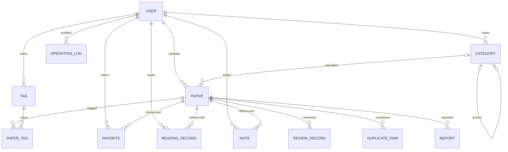

# PaperHub ER 与持久化说明 v1.1

MySQL >=8.0.16，InnoDB/utf8mb4；12张物理表。SQL结构以schema.sql为准，演示账号/样例分离至seed-demo.sql。新结构没有自动删库；已有库需要独立增量迁移。

## 实体关系

## 表及契约映射

| 表             | 接口                 | 关键字段及映射                                                                                                        |
| -------------- | -------------------- | --------------------------------------------------------------------------------------------------------------------- |
| user           | A1/P1–P4/M2–M6       | BCrypt密码、token_version、password_reset_at；管理员读取不返回密码                                                    |
| category       | K1–K6                | description→desc，owner_scope/parent_scope生成列解决NULL唯一性                                                        |
| tag            | K7–K11               | owner_scope+name唯一，自有与平台分离                                                                                  |
| paper          | U1–U12/M4/M7–M14     | JSON数组、file_size_mb→fileSizeMB、deleted_at、version、offline_reason                                                |
| paper_tag      | U3/U7/K7/K10/K11     | 联合主键；tagIds由关联查询组成，返回数组                                                                              |
| favorite       | R1/R2/M26            | (user_id,paper_id)唯一；只保证行唯一，toggle不是幂等                                                                  |
| reading_record | R3–R5/M27/P5/P6      | (user_id,paper_id)唯一；added_at不因更新重置                                                                          |
| note           | R6–R9/M28            | title最大300，paper_title关联时快照，失效论文仍保留笔记                                                               |
| review_record  | M13–M15              | paper_title/uploader_id审核快照，只追加                                                                               |
| duplicate_pair | M16–M20              | original_paper_id/new_paper_id、两个标题快照、doi_match/title_similarity/file_hash_match/submitted_at；状态与前端相同 |
| report         | M21–M23              | created_at、paper_title快照、处理人/时间/结果                                                                         |
| operation_log  | M24及写操作/敏感读取 | user_id/user_name/action/target/result/time；target明确用户和资源ID，不含正文                                         |

## 约束与生命周期

- paper逻辑删除：设置deleted_at，不物理DELETE；个人记录与审核/举报/重复对保留。paper关联外键使用RESTRICT，避免意外硬删除。
- 私有review_status=NULL；共享必须在pending/approved/rejected/offline中，offline同时要求withdrawn或moderation。生成列和CHECK不能由DTO直接写入。
- shared_doi_key/shared_file_key只在shared、未删除、非rejected时取规范化DOI/真实SHA-256。UNIQUE并发兜底；私有可重复，待审和下架仍占用共享标识。
- doi_normalized由应用去前缀/trim/转小写；上传哈希由实际文件计算。演示数据没有PDF，不伪造哈希；真实服务拒绝缺文件的上传与审核。
- 分类唯一键=(owner_scope,parent_scope,name)；标签=(owner_scope,name)。owner_id NULL代表平台，生成scope=0；普通ID从1起。custom与owner一致性CHECK。
- 分类parent_id为自引用RESTRICT，Service先锁子树检查归属、解除论文关联，再从叶到根删除；含他人自有项则拒绝。paper.category_id SET NULL。生成列基列不配置级联外键，以兼容MySQL。
- 重复对仅允许pending→终态一次；同original/new组合唯一。终态行直接形成处理记录，不假装可保存同一对多次覆盖历史；需要重新比对的新版本必须使用新的资源记录。
- report/review/duplicate使用快照展示，更新原论文不改历史。文件清理在事务提交后执行，可重试；权限失效不依赖文件是否清理成功。

## 事务

上传/编辑及标签、审核及流水、重复处理及驳回、举报及下架、逻辑删除、分类子树变更、账号管理及操作日志按业务事务提交。并发用条件UPDATE/version或行锁；约束冲突转换1004。

管理员查看私有论文、PDF、他人收藏/阅读/笔记先写独立审计事务，失败不返回敏感内容。管理员拥有用户确认的最高读取权限，普通用户仍按user_id隔离。

## 查询与索引

paper基础筛选索引、共享上传时间/下载量组合索引，paper_tag按tag反查，note按user/paper，日志按time/action。全文索引仅title/abstract，不等于U10全部字段的搜索；作者/关键词JSON及期刊/DOI采用参数化查询，正确性先于优化。排序、总数和多标签必须对论文去重。

统计和名字为派生字段：uploaderName关联user.name；paperCount按调用者可见性聚合；月度阅读按当前last_read_at归月。M25来自应用配置，不要求额外设置表。

## 迁移与验证

当前未部署后端，不提供未经验证的在用库迁移。schema.sql仅空库；seed-demo.sql含公开演示账号，仅开发手动导入。存量库升级先备份、检查重复、回填标题快照与DOI规范值，再加约束；不能用重跑建表替代迁移。
