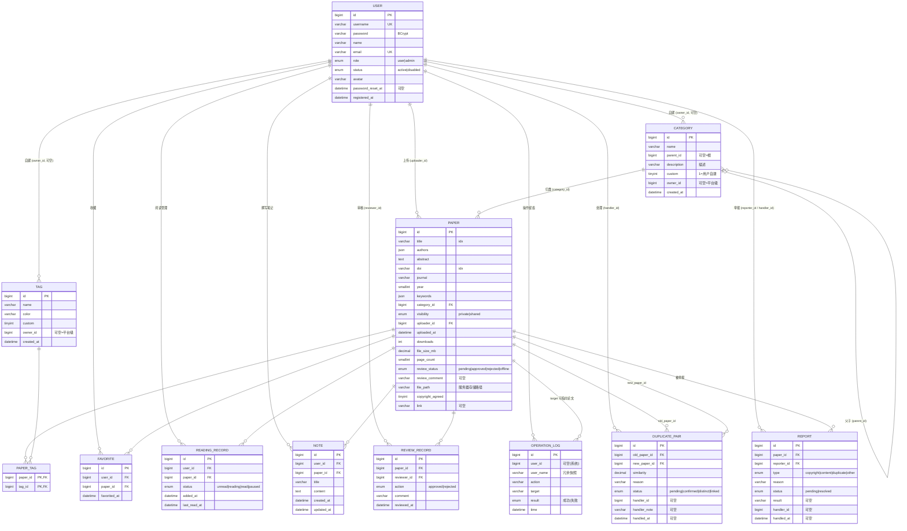

# PaperHub 数据库 ER 设计（MySQL 8）

> 版本：v1.0 ｜ 依据：`paperhub-api/api-spec.md`（64 端点）与 `ts/types.ts` 实体定义
> 引擎：InnoDB ｜ 字符集：utf8mb4 ｜ 对应后端：Java 8 + Spring Boot + MyBatis-Plus

## 一、ER 总图

## 二、表清单与职责

| # | 表 | 对应端点组 | 说明 |
| --- | --- | --- | --- |
| T1 | `user` | A1、P1–P4、M2–M6 | 普通用户与管理员同表，`role` 区分 |
| T2 | `paper` | U1–U9、M7–M14 | 核心实体；`file_path` 存服务器文件路径（第一阶段文件仍走本地磁盘，不入库） |
| T3 | `category` | K1–K6 | 树形（`parent_id` 自引用），`custom=1` 为用户自建 |
| T4 | `tag` + `paper_tag` | K7–K11 | 多对多关联表 |
| T5 | `favorite` | R1–R2 | UK(user_id, paper_id) 幂等收藏 |
| T6 | `reading_record` | R3–R5 | UK(user_id, paper_id)，toggle/patch 天然幂等 |
| T7 | `note` | R6–R9 | 仅本人可见（应用层强制 user_id 过滤） |
| T8 | `review_record` | M15 | 每次审核一条流水，审核状态冗余在 paper 表 |
| T9 | `duplicate_pair` | M16–M20 | 一对多查重结果；处理动作同时写 duplicate 处理记录语义 |
| T10 | `report` | M21–M23 | 举报单；`status` 区分待处理/已处理（处理记录页查询 `resolved`） |
| T11 | `operation_log` | M24 | 服务端写操作自动留痕；`user_name` 冗余防用户被删后日志失义 |

> 说明：前端 mock 的 `DuplicateRecord`（处理记录）由 `duplicate_pair.status != 'pending'` 的行直接映射（含 action 推导：confirmed→confirm 等），不设独立表。

## 三、关键设计决策

1. **审核状态冗余 + 流水分离**：`paper.review_status` 承载当前态（列表过滤快），`review_record` 只追加（历史审计）。approve/reject 同时更新两者，事务保证。
2. **分类/标签双轨制**：`owner_id IS NULL` 为平台级（管理员可操作），`owner_id = 用户` 为自建（仅本人+管理员可操作）。UK 约束：平台级 `(name, parent_id, owner_id NULL)` 与自建 `(name, parent_id, owner_id)` 重名各不冲突——用函数索引或应用层校验，DDL 中以应用层校验为准（MySQL 唯一索引对 NULL 不去重，行为恰好一致）。
3. **防环**：分类移动的环检测在服务端应用层完成（DFS），不入 SQL 约束。
4. **级联规则**（与前端已验证行为一致）：
   - 删除论文 → `favorite`/`reading_record`/`note`/`paper_tag`/`review_record` 关联行 `ON DELETE CASCADE`；`duplicate_pair`/`report` 中被引用时**应用层拦截**（提示先处理举报/重复对）或置 NULL，DDL 采用 `ON DELETE SET NULL` + 冗余标题列。
   - 删除用户 → 论文不删（`uploader_id` 保留），仅禁用账号（`status=disabled`），与 M5 行为一致。
5. **JSON 字段**：`authors`、`keywords` 用 MySQL 8 JSON 类型（前端为字符串数组，MyBatis TypeHandler 映射）。
6. **下载计数**：`POST /papers/{id}/download` 时 `downloads = downloads + 1`（原子 UPDATE，不依赖读-改-写）。
7. **密码**：BCrypt 存储；`password_reset_at` 记录管理员重置时间（映射 `AdminUser.passwordResetAt`，替代前端 mock 的 `isPasswordReset`）。
8. **时间**：所有 `*_at` 用 `DATETIME`，应用层格式化为 `yyyy-MM-dd HH:mm:ss`；不依赖 MySQL 时区函数。

## 四、索引设计（查询热路径）

| 表 | 索引 | 支撑的查询 |
| --- | --- | --- |
| paper | `idx_status_visibility(review_status, visibility)` | U10 共享库只出 approved+shared；M7/M12 状态过滤 |
| paper | `idx_title(title)`、`idx_doi(doi)` | U10 模糊搜索（前缀走索引，中缀走全文检索扩展）、U6/M7 DOI 查重 |
| paper | `idx_uploader(uploader_id)`、`idx_category(category_id)`、`idx_year(year)` | U1 我的论文、K6 分类论文、年份筛选 |
| user | `uk_username(username)`、`uk_email(email)`、`idx_name_role_status(name, role, status)` | A1 登录、M2 关键字过滤 |
| note | `idx_user_paper(user_id, paper_id)` | R6 按论文过滤 |
| operation_log | `idx_time(time)`、`idx_action(action)` | M24 过滤 |
| review_record / report / duplicate_pair | `idx_paper(paper_id)`、`idx_status(status)` | 各列表页 |

## 五、初始化数据

`schema.sql` 末尾含演示数据初始化（对应前端 mock）：

- 用户：`researcher`（id=1，林知远，普通用户）、`admin`（id=101，平台管理员）；密码分别为 `123456`、`admin123` 的 BCrypt 值（部署时以真实 BCrypt 替换占位）
- 平台级分类树、标签若干
- 共享论文（approved）+ 待审核论文（pending）若干，`uploader_id` 对应 mock 用户

## 六、落地文件

- [schema.sql](./schema.sql)：MySQL 8 可执行 DDL（建库 `paperhub` + 11 张表 + 索引 + 演示数据），`utf8mb4_general_ci`
- 后续 MyBatis-Plus 实体类字段与本设计一一对应，枚举字段用字符串存储（便于排查），不用 MySQL ENUM 之外的数字编码
